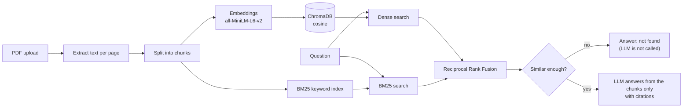

# RAG PDF Q&A

Upload PDFs, then ask questions in plain English. The app finds the relevant parts of your documents and an LLM writes the answer **using only those parts**, with citations back to the file and page.

Built with FastAPI, Streamlit, ChromaDB, sentence-transformers, BM25 and Groq / OpenAI.

## Features

- **Hybrid retrieval:** semantic search (embeddings) and keyword search (BM25) merged with Reciprocal Rank Fusion.
- **Grounded answers with citations:** every answer points to the file and page it came from (`[1]`, `[2]`, ...).
- **"Not found" instead of guessing:** if the documents do not contain the answer, the app says so and skips the LLM call.
- **Two interfaces:** a Streamlit chat UI and a REST API (FastAPI, interactive docs at `/docs`).
- **Safe uploads:** filename sanitising, PDF signature check, size limit, and re-uploading a file replaces it instead of duplicating chunks.
- **Provider choice:** Groq or OpenAI, selected through `.env`. Model names are configuration, not hard-coded.
- **Tested:** 64 automated tests that run without an API key or a model download.
- **Retrieval evaluation script:** measures hit@k and MRR for dense vs BM25 vs hybrid on your own documents.

## How it works



| Step | File | What it does |
| --- | --- | --- |
| 1. Ingest | `src/ingestion.py` | Reads each PDF page (`pypdf`) and splits it into overlapping chunks (default 500 characters, 50 overlap). |
| 2. Store | `src/vectorstore.py` | Embeds chunks with `all-MiniLM-L6-v2` and stores them in ChromaDB using **cosine** distance. Chunk IDs are deterministic, so re-uploading a file replaces its chunks. |
| 3. Retrieve | `src/retriever.py` | Dense + BM25 search, merged with RRF. Keyword-only hits keep their real file and page metadata. |
| 4. Generate | `src/generator.py` | Builds a prompt with numbered context blocks and asks the LLM to answer from them only, with citations. |
| Glue | `src/service.py` | The whole pipeline in one class, used by both the API (`app.py`) and the UI (`ui.py`). |

## Quick start

**Requirements:** Python 3.10 or newer.

```bash
git clone https://github.com/owais61/rag-pdf-qa.git`
cd rag-pdf-qa

python -m venv venv
source venv/bin/activate          # Windows: venv\Scripts\activate
pip install -r requirements.txt

cp .env.example .env              # Windows: copy .env.example .env
# open .env and paste your GROQ_API_KEY (or OPENAI_API_KEY)
```

The first run downloads the embedding model (about 90 MB).

### Option A: chat UI

```bash
streamlit run ui.py
```

Open the link Streamlit prints, click **Load sample PDF** in the sidebar (or upload your own), and ask a question.

### Option B: REST API

```bash
uvicorn app:app --reload --port 8000
```

Open <http://localhost:8000/docs> for the interactive API page, or use curl:

```bash
# upload a PDF
curl -X POST -F "file=@docs/sample/technova_faq_sample.pdf" http://localhost:8000/upload

# ask a question
curl -X POST http://localhost:8000/query \
  -H "Content-Type: application/json" \
  -d '{"query": "How many paid leaves does an employee get per year?"}'
```

Example response:

```json
{
  "answer": "Every employee gets 24 paid leaves per year [1].",
  "answered": true,
  "sources": [
    {"ref": 1, "file": "technova_faq_sample.pdf", "page": 1, "snippet": "Every employee gets 24 paid leaves per year and 12 sick leaves ..."}
  ],
  "usage": {"input_tokens": 480, "output_tokens": 35}
}
```

(The exact wording and token counts depend on the model.)

| Endpoint | Purpose |
| --- | --- |
| `POST /upload` | Upload and index a PDF (re-uploading the same filename replaces it). |
| `POST /query` | Ask a question. Body: `query`, optional `top_k` (1-10). |
| `GET /documents` | List indexed documents and their chunk counts. |
| `DELETE /documents/{filename}` | Remove a document. |
| `GET /health` | Status, number of chunks, and which LLM is configured. |

## Configuration

All settings are environment variables (see `.env.example`).

| Variable | Default | Meaning |
| --- | --- | --- |
| `GROQ_API_KEY` / `OPENAI_API_KEY` | empty | Set one of them. |
| `LLM_PROVIDER` | `auto` | `auto` uses Groq if its key is set, otherwise OpenAI. Or force `groq` / `openai`. |
| `GROQ_MODEL` | `openai/gpt-oss-20b` | Providers retire models over time. If you see `model_not_found`, pick a current model from the provider's list. |
| `OPENAI_MODEL` | `gpt-4o-mini` | |
| `CHUNK_SIZE` / `CHUNK_OVERLAP` | `500` / `50` | Characters per chunk. Re-upload your PDFs after changing them. |
| `TOP_K` | `4` | Chunks sent to the LLM. |
| `MIN_SIMILARITY` | `0.25` | If the closest chunk is below this cosine similarity, the app answers "not found" without calling the LLM. Tune it for your documents. |
| `MAX_UPLOAD_MB` | `10` | Upload size limit. |
| `EMBEDDING_MODEL` | `all-MiniLM-L6-v2` | If you change it, delete `data/vector_store` and re-upload (vector sizes differ). |

## Evaluation

Retrieval quality is measured without any LLM or API key. For each question the script checks whether the correct passage appears in the top-k retrieved chunks:

```bash
python -m eval.evaluate                       # sample PDF + eval/questions.json
python -m eval.evaluate --pdf my.pdf --questions my_questions.json --ks 1 3 5
```

It prints **hit@k** and **MRR** for dense-only, BM25-only and hybrid retrieval, so you can see whether hybrid actually helps on your data. `questions.json` is a list of `{"question": "...", "answer_contains": "..."}`.

The bundled set is small (14 questions on a 2-page PDF), so treat it as a sanity check; use your own documents for meaningful numbers.

## Tests

```bash
pip install -r requirements-dev.txt
pytest
```

The tests use a tiny stand-in embedder and a fake LLM, so they need no API key, no internet and no model download. They cover ingestion, the vector store (including no duplicates on re-upload), retrieval, prompt building, error handling and every API endpoint, plus a smoke test of the Streamlit UI.

Tested with Python 3.13, chromadb 1.5, FastAPI 0.162, Streamlit 1.67, langchain-core 1.7.

## Docker

```bash
docker build -t rag-pdf-qa .
docker run --env-file .env -p 8000:8000 -v "$(pwd)/data:/app/data" rag-pdf-qa
```

The `data` volume keeps your uploaded PDFs and the vector database between restarts.

## Project structure

```text
rag-pdf-qa/
├── app.py                  FastAPI backend
├── ui.py                   Streamlit chat UI
├── src/
│   ├── config.py           settings from environment variables
│   ├── ingestion.py        PDF -> pages -> chunks
│   ├── vectorstore.py      embeddings + ChromaDB
│   ├── retriever.py        dense + BM25 + Reciprocal Rank Fusion
│   ├── generator.py        prompt, LLM call, citations
│   ├── service.py          the pipeline used by app.py and ui.py
│   └── utils.py            safe filenames
├── eval/                   retrieval evaluation (hit@k, MRR)
├── tests/                  pytest suite
├── docs/sample/            sample PDF for trying the app
├── Dockerfile
└── .github/workflows/      CI: runs the tests on every push
```

## Limitations

- Text PDFs only. Scanned PDFs (images) are rejected because there is no OCR.
- No user accounts: all uploaded documents live in one shared collection.
- Each question is answered on its own (no chat memory).
- No reranker yet. A cross-encoder reranker on top of hybrid retrieval is a natural next step.
- `MIN_SIMILARITY` is a simple cut-off and needs tuning per document set.

## License

No license is included yet. Add one (for example MIT) if you want others to reuse the code.
